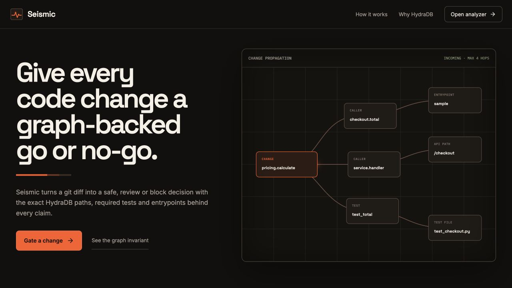
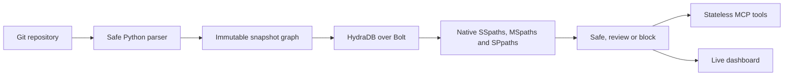
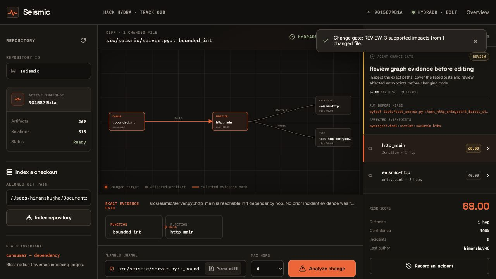

# Seismic

Graph-native change gates for coding agents, built on HydraDB.

Seismic tells a coding agent whether to proceed, review or stop before it edits code. It maps a real git diff to an immutable dependency graph, follows reverse dependency paths with HydraDB's native path procedures and returns exact tests, entrypoints and path evidence for every decision.

Seismic is built for Hack Hydra Track 02B: Repos, Dependencies + Code as Graphs.



## Why this is a graph problem

Text similarity can find code that looks related. It cannot prove that a CLI starts at a function, a test covers a caller or one function reaches another through two exact calls. Seismic models those facts as edges and asks HydraDB for bounded paths.



The direction invariant is simple: a consumer points to its dependency. Blast radius walks those relationships in the incoming direction.

## What works

- Immutable Git snapshots with a validated final pointer flip
- Files, functions, classes, tests, entrypoints and package versions as graph artifacts
- `PART_OF`, `IMPORTS`, `CALLS`, `TESTS`, `STARTS_AT` and `DEPENDS_ON` relationships
- Native HydraDB `algo.SSpaths`, `algo.MSpaths` and `algo.SPpaths` traversal
- Automatic symbol discovery from bounded unified diffs
- A deterministic agent change gate with safe, review and block decisions
- Required tests, affected entrypoints and CODEOWNERS routing from graph evidence
- Transparent risk scores based on path length, fan-in and incident history
- Incidents attached to stable identities so evidence survives new snapshots
- Stateless stdio and Streamable HTTP MCP transports
- A local landing page and live change analyzer backed by the same service as MCP
- Conservative abstention when a symbol cannot be resolved or a path does not exist

## Quick start

### Requirements

- Python 3.12
- Node.js 20 or newer for rebuilding the dashboard
- A source-built HydraDB `graph-node` listening on `neo4j://127.0.0.1:7687`
- The auth token used by `graph-node`

Docker is not required. Seismic uses the official `neo4j` Python driver and HydraDB's standard Bolt endpoint.

### Install

```bash
uv venv --python 3.12
uv pip install -e '.[dev]'
cd ui
npm ci
npm run build
cd ..
```

Set the connection and repository boundary:

```bash
export SEISMIC_TOKEN="$(< /absolute/path/to/graph-node-auth-token)"
export SEISMIC_ALLOWED_ROOTS=/absolute/path/to/your/repos
```

`SEISMIC_ALLOWED_ROOTS` is required. Seismic resolves symlinks and rejects any repository outside the configured roots.

### Run the dashboard

```bash
.venv/bin/seismic-web
```

Open [http://127.0.0.1:8791](http://127.0.0.1:8791). Index an allowed Git checkout, then enter a symbol or select **Paste diff** to run the agent change gate on `git diff --unified=0` output.

For the shortest judge path, keep the repository ID as `seismic`, enter the absolute path to this Seismic checkout and select **Index repository**. The prefilled diff changes `src/seismic/server.py::_bounded_int`. Running it returns `review`, the exact `test_http_entrypoint_forces_stateless_json_transport` test and the affected `seismic-http` entrypoint from HydraDB path evidence.



### Attach a coding agent over stdio

```json
{
  "mcpServers": {
    "seismic": {
      "command": "/absolute/path/to/seismic/.venv/bin/seismic",
      "env": {
        "SEISMIC_URI": "neo4j://127.0.0.1:7687",
        "SEISMIC_USERNAME": "neo4j",
        "SEISMIC_TOKEN": "your-graph-node-token",
        "SEISMIC_ALLOWED_ROOTS": "/absolute/path/to/your/repos"
      }
    }
  }
}
```

### Run stateless Streamable HTTP

```bash
.venv/bin/seismic-http
```

The endpoint is `http://127.0.0.1:8790/mcp`. HTTP is configured with `stateless_http=True`. Durable state lives in HydraDB, not in an MCP session or Python process.

## MCP tools

| Tool | Purpose |
|---|---|
| `index_repository` | Parse, validate and activate an immutable snapshot for one allowed Git checkout |
| `analyze_change` | Rank reverse dependency paths and return an actionable change gate |
| `analyze_diff` | Map patch lines to symbols, then return a combined safe, review or block decision |
| `retrieve_context` | Resolve lexical or agent-supplied seeds and expand grounded graph context |
| `explain_impact` | Return one exact path between a change and an affected artifact, or abstain |
| `record_incident` | Store real breakage evidence against stable artifact identities |
| `repository_status` | Report the active snapshot and its artifact counts |

Every tool has a short docstring because its description is part of the agent-facing MCP contract.

An agent can pass the output of `git diff --unified=0` directly to `analyze_diff`. Seismic never applies the patch. It validates every patch path, resolves touched line ranges against the active snapshot and sends the discovered symbols through the same HydraDB path engine.

## Agent change gate

Every `analyze_change` and `analyze_diff` response now includes a deterministic `gate` object:

- `safe`: the target resolved and no downstream path is supported within the requested bound
- `review`: supported impacts exist, or part of the supplied change could not be resolved
- `block`: a supported impact reaches the 75 risk threshold, or the exact trigger-impact pair has prior incident evidence

The gate also returns `required_tests`, ready-to-run `verification_commands`, `affected_entrypoints`, `affected_owners`, the maximum risk score and plain-language reasons. The policy lives in [`src/seismic/gate.py`](src/seismic/gate.py) so it is inspectable and replaceable. A `safe` result is bounded static evidence, not a claim of runtime certainty.

```json
{
  "decision": "review",
  "verification_commands": ["pytest tests/test_checkout.py::test_total"],
  "affected_entrypoints": ["pyproject.toml::script::sample"],
  "max_risk_score": 68.0
}
```

## HydraDB data model

```text
(:Repository)-[:HAS_SNAPSHOT]->(:Snapshot)-[:CONTAINS]->(:Artifact)
(:Artifact)-[:INSTANCE_OF]->(:ArtifactIdentity)
(:Artifact)-[:PART_OF|IMPORTS|CALLS|TESTS|STARTS_AT|DEPENDS_ON]->(:Artifact)
(:Incident)-[:TRIGGERED_BY]->(:ArtifactIdentity)
(:Incident)-[:IMPACTED]->(:ArtifactIdentity)
```

Snapshot artifacts are immutable. `ArtifactIdentity` nodes carry stable logical identity across commits. Incident evidence attaches to those stable nodes, which lets later snapshots learn from prior failures without rewriting history.

## Risk scoring

The score is intentionally inspectable. Each result includes the exact path plus score components for:

- hop distance
- incident count on the affected artifact
- incident count for the exact trigger and affected pair
- normalized fan-in
- artifact kind

Seismic does not claim runtime certainty. A result means the indexed static graph supports the path. An empty result means the available graph does not support a claim.

## Verification

### Remotion demo

The under-three-minute judge demo is an editable, caption-free Remotion composition. It recreates the real dependency graph, MCP output and checked-in proof as React components, with no generated imagery.

```bash
cd videos/seismic-remotion-demo
npm install
npm run audio:murf  # reads MURF_API_KEY from the environment
npm run lint
npm run render
```

The storyboard and bounded narration claims live beside the composition in `STORYBOARD.md` and `SCRIPT.md`.

### Fast gate

```bash
.venv/bin/ruff format --check src tests benchmarks
.venv/bin/ruff check src tests benchmarks
.venv/bin/mypy src
.venv/bin/pytest -q -m 'not integration'
cd ui && npm run build
```

### Live HydraDB gate

```bash
.venv/bin/pytest -q -m integration
```

The current suite collects 19 tests: 16 fast tests and 3 live integration tests. The live group covers direct Bolt behavior, unified-diff gating, a fresh stdio MCP process and fresh clients against sessionless Streamable HTTP.

### Self-authored Track 02 evaluation

```bash
PYTHONPATH=src .venv/bin/python -m benchmarks.track02_eval
```

The checked-in raw result is [benchmarks/results/track02-evaluation.json](benchmarks/results/track02-evaluation.json). It contains 12 manually source-reviewed tasks from HydraMind: 10 supported dependency cases and 2 abstention cases.

Current local result:

| System | Precision@k | Recall@k | MRR | Abstention |
|---|---:|---:|---:|---:|
| HydraDB graph | 1.0000 | 1.0000 | 1.0000 | 2/2 |
| TF-IDF baseline | 0.1321 | 0.1321 | 0.2250 | 2/2 |
| Graph-first hybrid | 1.0000 | 1.0000 | 1.0000 | 2/2 |

All 10 supported graph tasks also passed the exact path structure check. This is a self-authored track smoke, not an official hackathon score or a substitute for a large public benchmark.

### Real-repository portability smoke

```bash
PYTHONPATH=src .venv/bin/python -m benchmarks.real_repo_smoke \
  --repo hydramind=/path/to/hydramind \
  --repo omnidev=/path/to/omnidev \
  --repo blastradius=/path/to/blastradius
```

The checked-in [raw result](benchmarks/results/real-repositories.json) indexes three public Python repositories owned by the author. Before querying, the runner deterministically selects the function or class with the most direct incoming dependency edges. All three repositories returned supported impacts: 49 in total, with every returned evidence path passing the structural validity check. This is a portability smoke, not a claim that every Python construct is resolved.

### Deterministic stress proof

```bash
PYTHONPATH=src .venv/bin/python -m benchmarks.stress --queries 25
```

The checked-in raw result is [benchmarks/results/stress.json](benchmarks/results/stress.json). It verifies a synthetic graph with 5,000 artifacts and exactly 20,000 code relationships. The current isolated local run wrote all records in 35.294 seconds and recovered the required exact target in 25/25 queries, with 6.920 ms p50 and 8.926 ms p95 query latency. Each run uses a fresh repository namespace, so these are new-node writes rather than updates to an existing graph.

## Configuration

| Variable | Default | Meaning |
|---|---|---|
| `SEISMIC_URI` | `neo4j://127.0.0.1:7687` | HydraDB Bolt URI |
| `SEISMIC_USERNAME` | `neo4j` | Bolt username |
| `SEISMIC_TOKEN` | none | `graph-node` auth token |
| `SEISMIC_DATABASE` | `default` | HydraDB graph scope |
| `SEISMIC_ALLOWED_ROOTS` | empty | Path-separated repository roots, required for indexing |
| `SEISMIC_MAX_FILES` | `20000` | Repository file cap |
| `SEISMIC_MAX_FILE_BYTES` | `1000000` | Per-file byte cap |
| `SEISMIC_MAX_ARTIFACTS` | `100000` | Snapshot artifact cap |
| `SEISMIC_MAX_RELATIONSHIPS` | `500000` | Snapshot relationship cap |
| `SEISMIC_MAX_HOPS` | `8` | Native path traversal cap |
| `SEISMIC_MAX_RESULTS` | `200` | Impact result cap |
| `SEISMIC_MCP_PORT` | `8790` | Streamable HTTP port |
| `SEISMIC_WEB_PORT` | `8791` | Dashboard port |

## Current boundaries

- The production parser supports Python. More language adapters can reuse the same graph contract.
- Import and call resolution is conservative static analysis. Dynamic dispatch, reflection and runtime-generated code can be unresolved.
- Qualified-name fallback can be slower than exact logical-key resolution.
- Streamable HTTP is sessionless but intended for trusted local use. Add a real authentication boundary before exposing it on a network.
- The dashboard is a local operator surface. It is not a hosted multi-tenant control plane.

## Repository map

```text
src/seismic/config.py    validated environment and repository boundaries
src/seismic/db.py        official Neo4j driver and startup schema
src/seismic/parser.py    Python repository graph extraction
src/seismic/diffing.py   bounded unified-diff target discovery
src/seismic/ingest.py    immutable snapshot writer
src/seismic/tools.py     graph-native product operations
src/seismic/server.py    stateless MCP transports
src/seismic/web.py       dashboard API and static app
ui/                      React landing page and analyzer
benchmarks/              self-authored evaluation and stress proof
tests/                   fast, Bolt and real MCP transport checks
videos/                  Remotion judge demo, storyboard and narration script
```

## License

MIT
